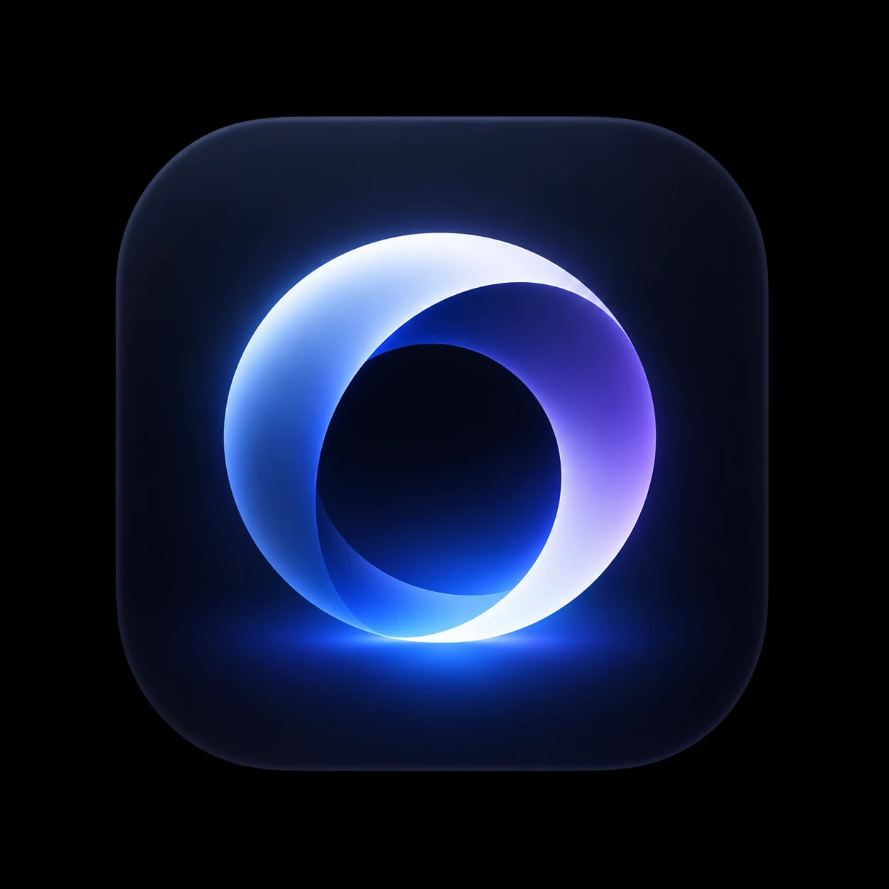
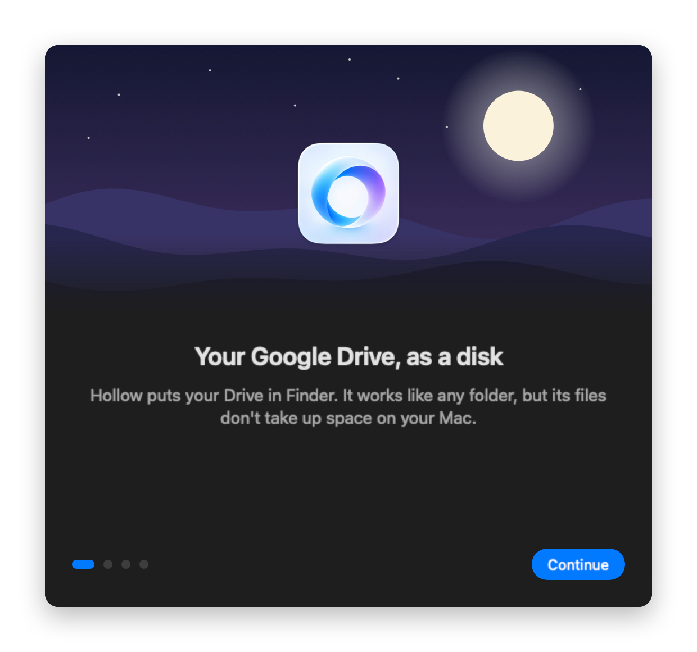
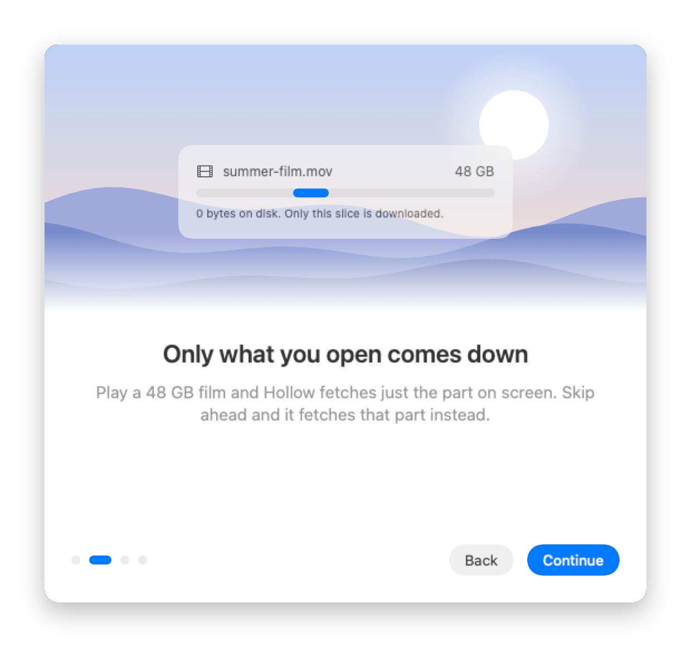
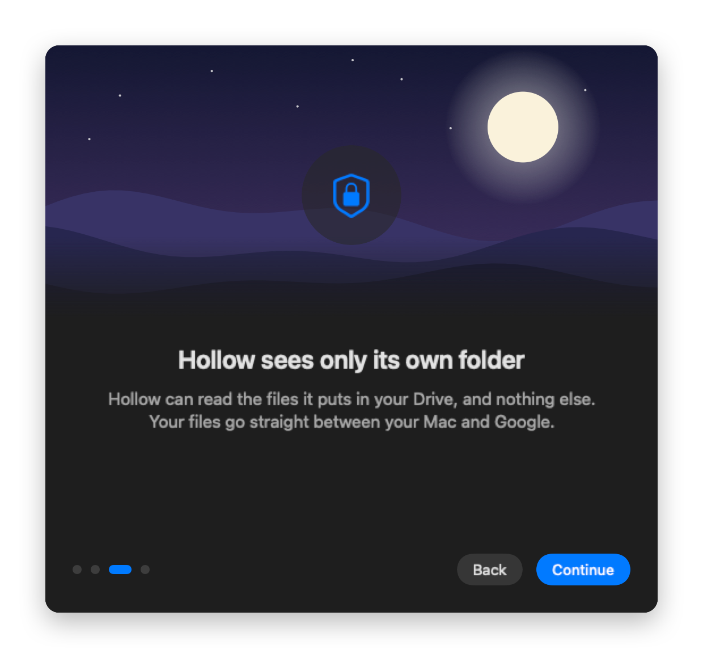
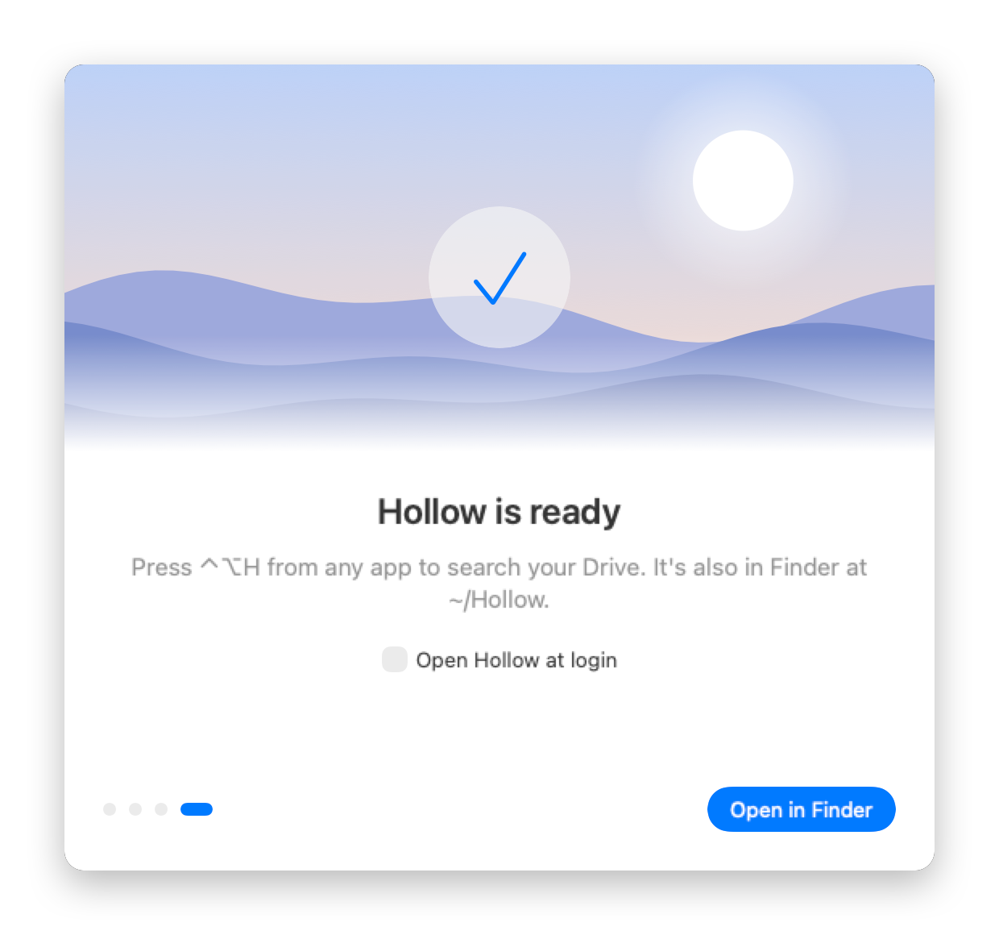
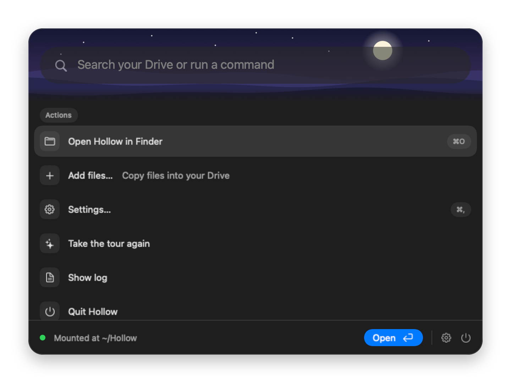
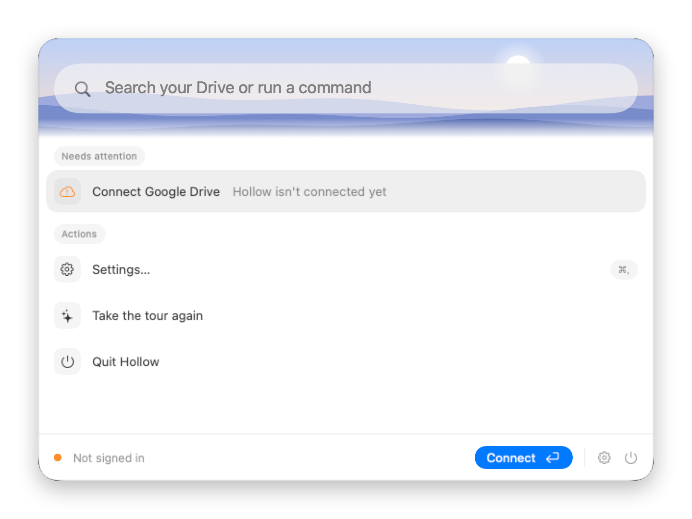
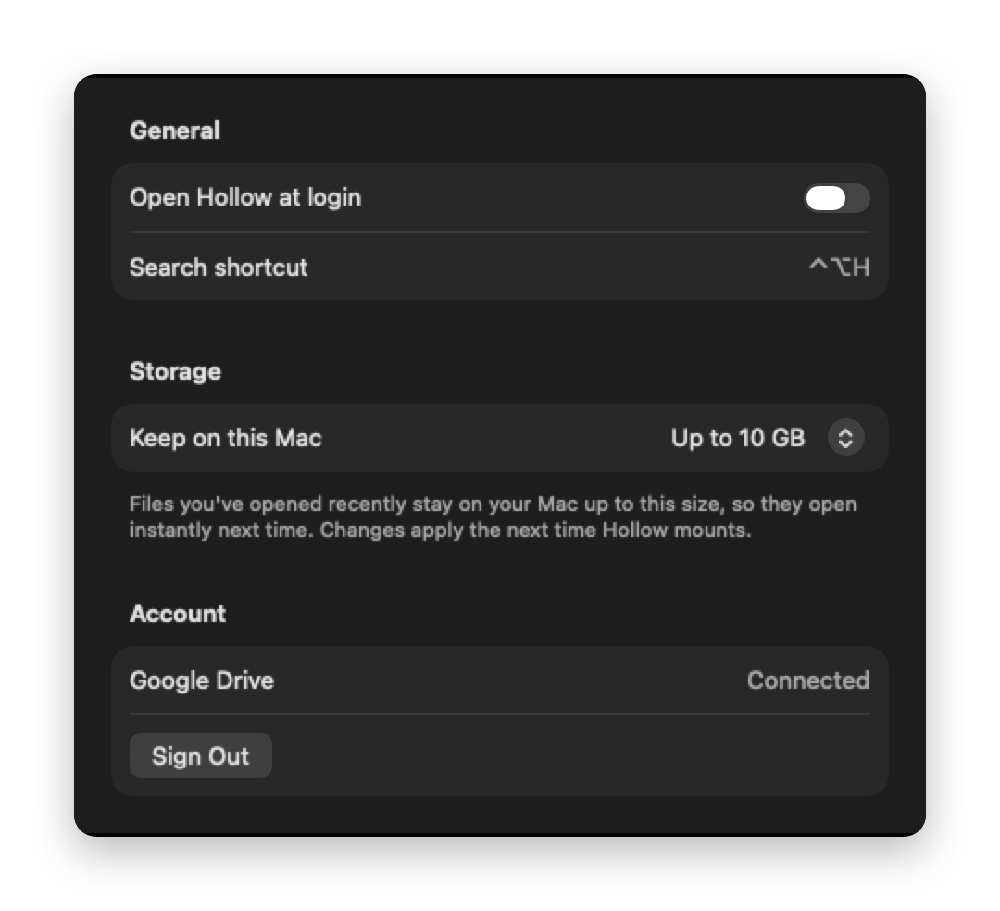
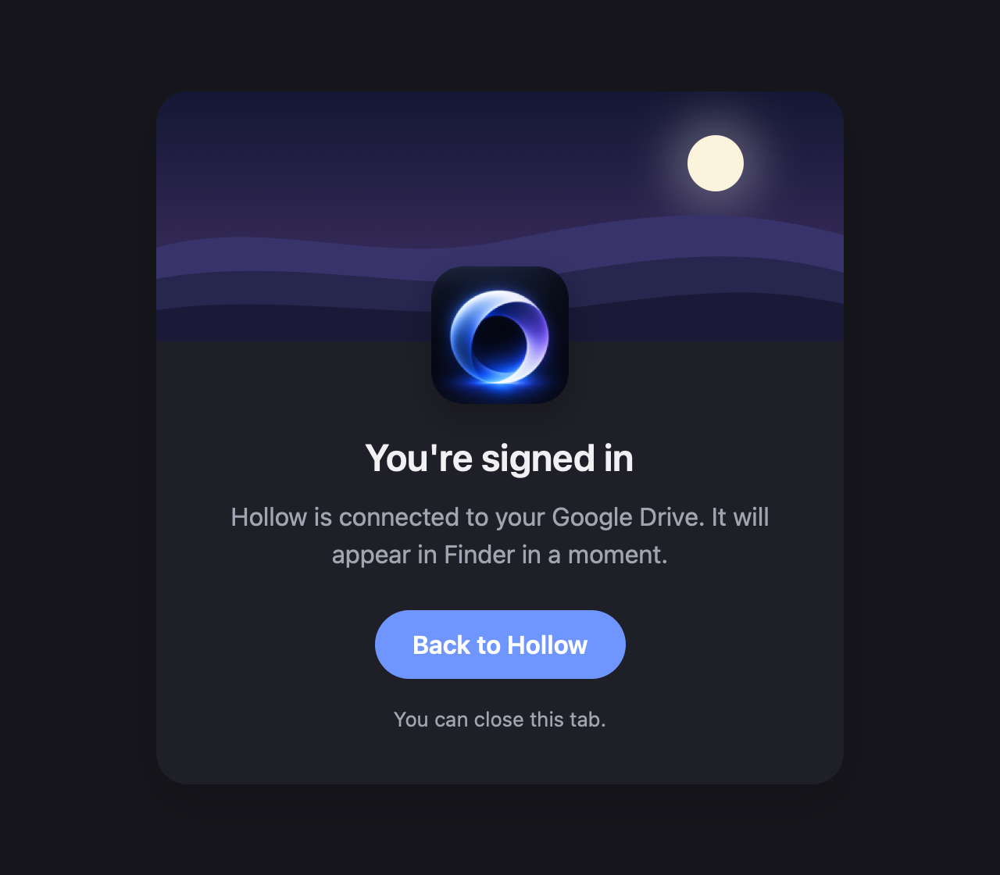
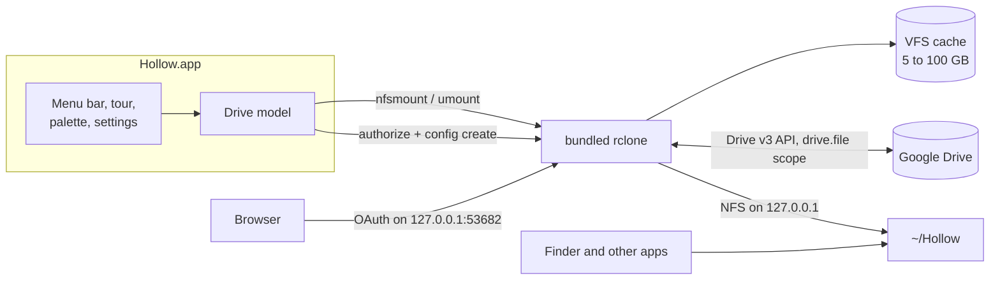

<p align="center">
  
</p>

<h1 align="center">Hollow</h1>

<p align="center">Your Google Drive as a disk on your Mac. Files stay in Drive; only the bytes an app reads come down.</p>

---

Hollow is a macOS menu-bar app that mounts your Google Drive at `~/Hollow`. Finder, QuickTime and
any other app see an ordinary folder. Opening a file downloads only the byte ranges the app actually
reads, so a 48 GB video starts playing without taking 48 GB of disk.

> **Status (2026-11-20).** The app signs in with your own Google client, mounts Drive, streams files
> by range, and has a first-run tour, a search palette and settings. It has been run end to end on
> one Mac against a real Drive. It is not yet signed with a Developer ID or notarized, so it only runs
> on the Mac that built it. A native FSKit version (a real disk with Eject) is designed and partly
> built on other branches, and is blocked on the paid Apple Developer Program. See
> [docs/06-roadmap.md](docs/06-roadmap.md).

## Screenshots

| First-run tour | Partial downloads, explained |
| --- | --- |
|  |  |
| **Privacy** | **Connected** |
|  |  |

| Search palette (Control-Option-H) | Before connecting |
| --- | --- |
|  |  |
| **Settings** | **Sign-in result page** |
|  |  |

Screenshots are rendered from the app's own SwiftUI views and the sign-in page template, so they
match the code on `main`.

## What has been verified

Each row was checked on one Apple Silicon Mac running macOS 27 unless it says otherwise.

| Claim | How it was checked | Result |
| --- | --- | --- |
| Only requested byte ranges are downloaded | Read 1 MB from the middle of a 50 MB file through the mount, then measured the cache | about 2 MB cached, not 50 MB |
| Mount and unmount work without macFUSE or root | `rclone nfsmount` started by the app; unmount from the app | mounts at `~/Hollow`; unmounts cleanly when the mount is detached before rclone stops |
| Sign-in with your own Google client | Real sign-in; the consent screen shows "Hollow" | token saved; Drive mounted |
| The sign-in result page renders through rclone | Real `rclone authorize` fed a failure response | Hollow's page served, with the error filled in |
| A stale mount cannot freeze launch | Reproduced a stuck NFS unmount, fixed it, retested | unmount runs off the main thread with a 10 s limit |
| Unit tests | `swift test` | 7 passing on `main`; 23 on `feature/drive-client` |
| Native Drive client (no rclone) | Live run against a real Drive on `feature/drive-client` | interrupted upload resumed; three ranged reads matched byte for byte |

Not verified yet: use with Final Cut Pro, DaVinci Resolve and other editors **[verify]**; behaviour on
Intel Macs (not supported); behaviour with very large Drive folders (search walks the tree).

## How it works



- **Sign-in.** `rclone authorize` opens Google in your browser and serves Hollow's own result page.
  The token is then saved with `rclone config create` into Hollow's own config file, separate from
  any rclone setup you already have.
- **Mount.** `rclone nfsmount` with `--vfs-cache-mode full` serves Drive over NFS on loopback, and
  macOS mounts it at `~/Hollow`. The cache stores sparse files, which is what makes range reads cheap.
- **Unmount.** Hollow detaches the mount first, while rclone's server is still running, then stops
  rclone. The reverse order can leave the kernel waiting on a server that is gone.

Details and the decisions behind them: [docs/01-architecture.md](docs/01-architecture.md).

## Privacy and security

- **Narrow scope.** Hollow requests only `https://www.googleapis.com/auth/drive.file`: it can see
  files it created, never the rest of your Drive.
- **No servers.** Files move directly between your Mac and Google. Hollow has no backend.
- **No secrets in the repository.** Each build gets its Google client from a JSON file passed to the
  build script. `client_secret*.json` is git-ignored, and the build rejects placeholder values.
- **Recoverable deletes in the native client.** `HollowDrive` moves files to Drive's bin rather than
  deleting them.

Threat model and residual risks: [docs/04-privacy-and-security.md](docs/04-privacy-and-security.md).

## Quick start

Requirements: Apple Silicon Mac, macOS 15 or later, Xcode 27, Homebrew.

```bash
brew install rclone
```

1. **Create a Google client** (free, about 10 minutes): a Google Cloud project with the Drive API,
   an **External** consent screen with yourself as a test user, the `drive.file` scope, and a
   **Desktop app** client. Download its JSON. Step by step: [docs/02-google-setup.md](docs/02-google-setup.md).
2. **Build:**
   ```bash
   ./scripts/build-app.sh ~/Downloads/client_secret_XXXX.json
   ```
3. **Run:**
   ```bash
   open dist/Hollow.app
   ```
   Go through the tour, click **Connect Google Drive**, and sign in. Your Drive appears at `~/Hollow`.

Development and tests:

```bash
swift test
HOLLOW_CLIENT_ID=... HOLLOW_CLIENT_SECRET=... swift run
```

## Repository layout

| Path | What it is |
| --- | --- |
| `Sources/Hollow/` | The app: menu bar, tour, palette, settings, and `Drive`, which runs rclone |
| `Resources/signin.html` | The page shown in the browser after Google sign-in |
| `Tests/HollowTests/` | Unit tests for rclone arguments, token parsing and the mount check |
| `scripts/build-app.sh` | Builds `dist/Hollow.app` with rclone, licences and the icon inside |
| `scripts/make-icon.sh` | Rebuilds the light and dark icon art in `branding/Hollow.icon` |
| `branding/` | Logos, the Icon Composer icon, and the consent-screen logo |
| `docs/` | Design record: architecture, setup, security, testing, roadmap |

| Branch | Contents |
| --- | --- |
| `main` | The app described above |
| `feature/drive-client` | `HollowDrive`, a native Google Drive client with resumable uploads and ranged reads |
| `spike/fskit` | A minimal FSKit extension that would make Hollow a real disk; blocked on account type |

## Documentation

Start at [docs/README.md](docs/README.md) for the reading order.

## Licence

GPL-3.0, see [LICENSE](LICENSE). Hollow bundles [rclone](https://rclone.org) (MIT); its licence
ships inside the app as `rclone-LICENSE.txt`.

The source is free to build. A signed, notarized build is intended to be sold as a convenience;
there is no licence check in the code, by design.
