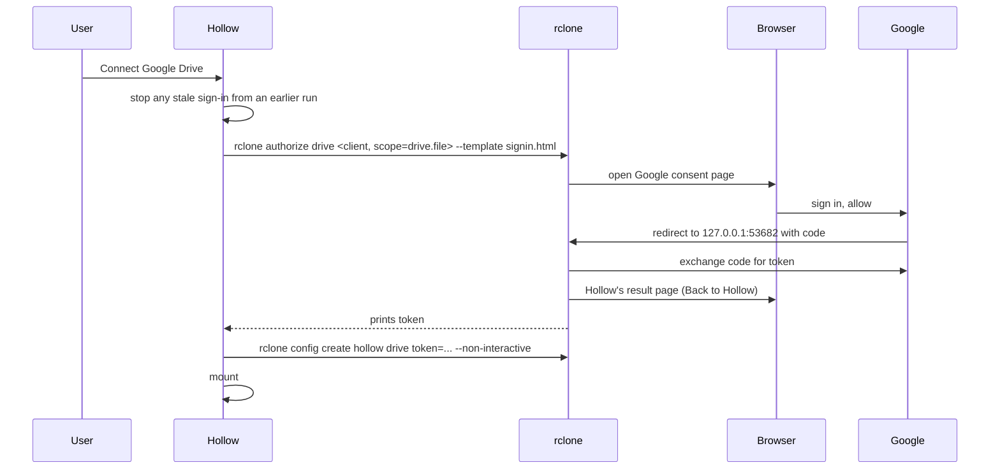

# 01 — Architecture

## Layers

```
┌──────────────────────────────────────────────────────────────────────┐
│ Surfaces   menu bar, first-run tour, palette (Ctrl-Opt-H), settings  │  HollowApp, MenuContent,
│                                                                      │  OnboardingView, PaletteView
├──────────────────────────────────────────────────────────────────────┤
│ State      Drive: phase (idle, busy, mounted, failed), sign-in,      │  Drive.swift
│            notices; runs rclone, never blocks the main thread        │
├──────────────────────────────────────────────────────────────────────┤
│ Commands   rclone arguments as pure values (testable)                │  Rclone.swift
├──────────────────────────────────────────────────────────────────────┤
│ Engine     bundled rclone: authorize, config create, nfsmount        │  Contents/MacOS/rclone
├──────────────────────────────────────────────────────────────────────┤
│ System     NFS client in macOS, mounted at ~/Hollow                  │
└──────────────────────────────────────────────────────────────────────┘
```

## Components

| Component | File | Owns |
| --- | --- | --- |
| App entry and scenes | `HollowApp.swift` | Menu-bar item, the tour window, Settings |
| App delegate | `AppDelegate.swift` | Activation on launch and reopen, `hollow://` links, ending sign-in on quit |
| Drive state | `Drive.swift` | Sign-in, mount, unmount, sign-out, add files, all process handling |
| rclone commands | `Rclone.swift` | Arguments for authorize, save-token and mount; token parsing; mount-table lookup |
| Palette | `PaletteView.swift`, `PaletteController.swift`, `PalettePanel.swift`, `PaletteRow.swift` | Search and actions in a non-activating floating panel |
| Global shortcut | `GlobalHotKey.swift` | Control-Option-H via Carbon `RegisterEventHotKey` (no Accessibility permission) |
| File search | `FileSearch.swift` | Name search over the mount, off the main actor, cancellable |
| Window focus | `BringForward.swift` | Raising Hollow's windows above other apps |
| Visuals | `HollowScene.swift`, `StreamingDemo.swift`, `MenuBarGlyph.swift` | The illustration, the tour animation, the menu-bar icon |
| Sign-in page | `Resources/signin.html` | Go template served by rclone after Google sign-in |

## Sign-in path



The token goes into `~/Library/Application Support/Hollow/rclone.conf`, never into a user's own
rclone configuration.

## Mount path

`rclone nfsmount hollow: ~/Hollow --vfs-cache-mode full --vfs-cache-max-size <N>G` starts an NFS
server on loopback and asks macOS to mount it. Hollow then polls the kernel mount table (via
`getmntinfo` with `MNT_NOWAIT`, which never touches the mount itself) until the mount appears, for
up to 10 seconds.

## Unmount order

Hollow runs `umount ~/Hollow` first, then sends rclone SIGTERM. Stopping rclone first can shut its
NFS server down before the kernel has detached, leaving `umount -f` waiting indefinitely in the
kernel. This was reproduced on 2026-11-10 and is the reason for the order. If the mount is busy,
Hollow stays mounted and shows "Close files open from Hollow, then try again" instead of hanging.

## Decisions

| Decision | Alternative | Why |
| --- | --- | --- |
| rclone `nfsmount` | macFUSE, FUSE-T | No kernel extension or third-party install; works without root |
| `--vfs-cache-mode full` | `writes` or `off` | Sparse cache files make range reads cheap and let editors seek |
| `drive.file` scope | Full `drive` scope | Non-sensitive scope: no Google security audit, and Hollow cannot read unrelated files |
| Builder's own OAuth client | rclone's shared client | The shared client is being retired in 2026, has shared quotas, and shows "rclone" on the consent screen |
| `rclone authorize` then `config create` | `config create` alone | Only `authorize` accepts `--template`, which gives the branded result page |
| Palette in a non-activating `NSPanel` | A SwiftUI `Window` | Menu-bar apps are often refused activation; a non-activating panel still takes keystrokes |
| `orderFrontRegardless` for windows | `NSApp.activate()` only | Activation is refused right after launch; ordering front is not |
| Detach mount, then stop rclone | SIGTERM first | See [Unmount order](#unmount-order) |
| Kernel mount table for mount checks | `statfs` on the path | `statfs` on a dead NFS mount can block |
| Keep the cache on sign-out | Delete it | It can hold writes not yet uploaded; rclone uploads them on the next mount |

## Where state lives

| What | Path |
| --- | --- |
| Mount | `~/Hollow` |
| rclone config and token | `~/Library/Application Support/Hollow/rclone.conf` |
| Read cache | `~/Library/Application Support/Hollow/cache` |
| Log | `~/Library/Application Support/Hollow/rclone.log` |
| Cache size setting | `UserDefaults`, key `cacheLimitGB` |
